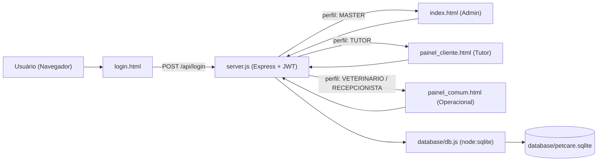
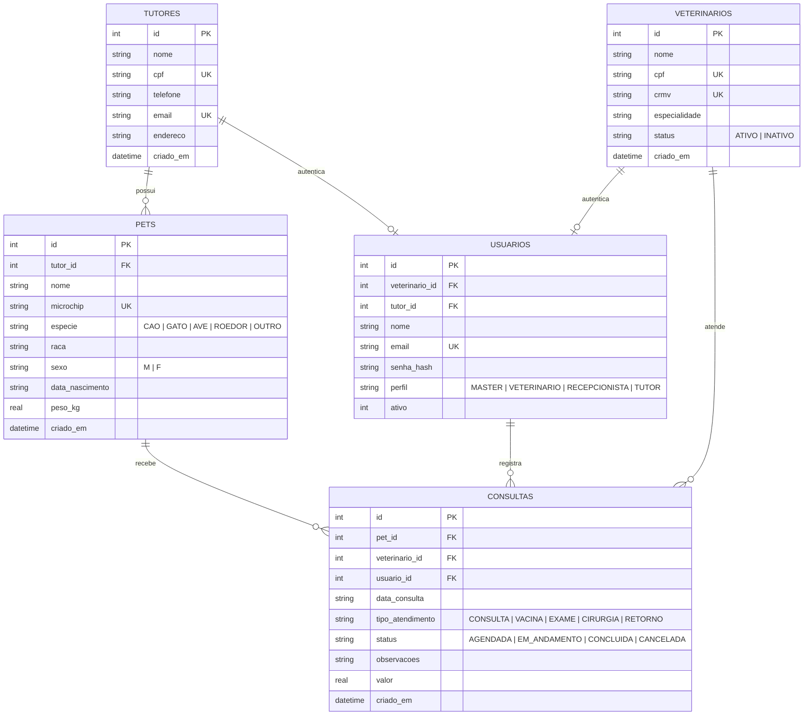

# 🐾 PetCare (SGP) - Sistema de Gerenciamento de Pets e Tutores


-blue.svg)

O **PetCare (SGP)** é um sistema web para gestão de clínicas veterinárias, permitindo o gerenciamento completo de **tutores**, **pets**, **veterinários**, **equipe de recepção** e **consultas/atendimentos**. O banco de dados SQLite é local e **auto-configurável na primeira execução**.

---

## ⚙️ 1. Pré-requisitos

* **Node.js v22+** (necessário para o módulo nativo `node:sqlite`)
* **npm** (incluso no Node.js)

---

## 📂 2. Estrutura do Projeto

```text
Prova_Saep/
├── database/
│   ├── db.js                  # Conexão SQLite e auto-configuração inicial
│   ├── banco_de_dados.sql     # Script SQL de referência (MySQL)
│   └── petcare.sqlite         # Gerado automaticamente na 1ª execução (ignorado no Git)
│
├── public/                    # Frontend estático (HTML + Bootstrap 5)
│   ├── assets/css/style.css   # Estilos customizados
│   ├── login.html             # Login, auto-cadastro de Tutor e setup inicial
│   ├── index.html             # Painel Administrativo (MASTER)
│   ├── painel_cliente.html    # Painel do Tutor (Meus Pets e Agendamentos)
│   └── painel_comum.html      # Painel Operacional (VETERINARIO e RECEPCIONISTA)
│
├── .env.example               # Modelo de variáveis de ambiente
├── .gitignore                 # Regras do Git (ignora .env, node_modules e *.sqlite*)
├── gerar_senha.js             # Utilitário para gerar hash bcrypt
├── package.json               # Dependências e scripts
└── server.js                  # API REST Express + autenticação JWT + RBAC
```

---

## 🏗️ 3. Arquitetura e Fluxo do Sistema



---

## 🗄️ 4. Banco de Dados

### Auto-configuração na primeira execução
Ao iniciar a aplicação com `npm start`, o módulo [database/db.js](database/db.js) executa automaticamente:
1. Cria o arquivo SQLite em `DB_PATH` (padrão: `./database/petcare.sqlite`) e habilita `PRAGMA foreign_keys = ON` e `journal_mode = WAL`.
2. Executa `CREATE TABLE IF NOT EXISTS` para todas as tabelas.
3. Verifica se existe algum usuário `MASTER` cadastrado. Caso não exista, cria automaticamente o administrador inicial usando `ADMIN_NAME`, `ADMIN_EMAIL` e `ADMIN_PASSWORD` do `.env` (ou assume o padrão `Administrador` / `admin@petcare.com.br` / `Admin1234`).

### Diagrama Entidade-Relacionamento (DER)



### Resumo das Tabelas
* **`veterinarios`**: Cadastro dos profissionais com CPF, CRMV único, especialidade e status (`ATIVO`/`INATIVO`).
* **`tutores`**: Cadastro dos responsáveis pelos pets (CPF e e-mail únicos).
* **`usuarios`**: Credenciais de acesso e controle de perfil (`MASTER`, `VETERINARIO`, `RECEPCIONISTA`, `TUTOR`).
* **`pets`**: Animais vinculados a um `tutor_id` (`ON DELETE CASCADE`), com espécie, raça, sexo, peso, data de nascimento e microchip opcional.
* **`consultas`**: Agendamentos e prontuário resumido ligando `pet_id`, `veterinario_id` e `usuario_id`, com status (`AGENDADA`, `EM_ANDAMENTO`, `CONCLUIDA`, `CANCELADA`) e valor.

---

## 🚀 5. Instalação e Execução

1. **Instale as dependências:**
   ```bash
   npm install
   ```

2. **Configure as variáveis de ambiente (opcional):**
   Copie `.env.example` para `.env` e ajuste conforme necessário:
   ```env
   PORT=3000
   DB_PATH=./database/petcare.sqlite
   JWT_SECRET=super_chave_secreta_petcare_2026
   ADMIN_NAME=Administrador
   ADMIN_EMAIL=admin@petcare.com.br
   ADMIN_PASSWORD=Admin1234
   ```

3. **Inicie o servidor:**
   ```bash
   npm start
   ```
   Para desenvolvimento com reload automático:
   ```bash
   npm run dev
   ```

4. **Acesse no navegador:**
   `http://localhost:3000/login.html`

---

## 👥 6. Perfis de Acesso e Funcionalidades

* **MASTER (`index.html`)**: Gerencia veterinários (gera e-mail automaticamente e define CPF como senha inicial), tutores, pets, consultas e usuários (`RECEPCIONISTA`/`MASTER`).
* **TUTOR (`painel_cliente.html`)**: Auto-cadastro na tela de login (senha inicial = CPF), cadastro/gerenciamento dos próprios pets e agendamento/cancelamento de consultas.
* **VETERINARIO (`painel_comum.html`)**: Visualiza a própria agenda de atendimentos, inicia consultas e conclui com observações clínicas e valor.
* **RECEPCIONISTA (`painel_comum.html`)**: Cadastra tutores e pets, realiza agendamentos e cancela consultas.

---

## 🔌 7. Principais Endpoints da API

| Recurso | Métodos | Descrição |
| :--- | :--- | :--- |
| `/api/login` | `POST` | Autenticação e emissão de token JWT |
| `/api/setup/status`, `/api/setup` | `GET`, `POST` | Verificação e criação inicial do `MASTER` (se vazio) |
| `/api/tutores/cadastro` | `POST` | Auto-cadastro público de tutor + usuário `TUTOR` |
| `/api/tutores` | `GET`, `PUT/:id`, `DELETE/:id` | Listagem, edição (sincronizada) e remoção de tutores |
| `/api/veterinarios` | `GET`, `POST`, `PUT/:id`, `DELETE/:id` | Gestão da equipe veterinária |
| `/api/usuarios` | `GET`, `POST`, `PUT/:id`, `DELETE/:id` | Gestão de usuários (`MASTER` / `RECEPCIONISTA`) |
| `/api/pets` | `GET`, `GET/tutor/:id`, `POST`, `PUT/:id`, `DELETE/:id` | CRUD de pets |
| `/api/consultas` | `GET`, `GET/tutor/:id`, `GET/veterinario/:id`, `POST`, `PUT/:id/processar`, `DELETE/:id` | Agendamento e ciclo de atendimento |

---

## 🛠️ 8. Tecnologias Utilizadas

* **Backend:** Node.js v22+ (`node:sqlite`), Express 4, JWT (`jsonwebtoken`), Bcrypt, Dotenv, CORS.
* **Frontend:** HTML5, CSS3, Bootstrap 5.
